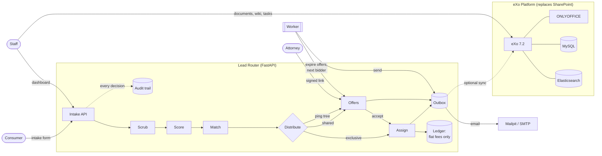
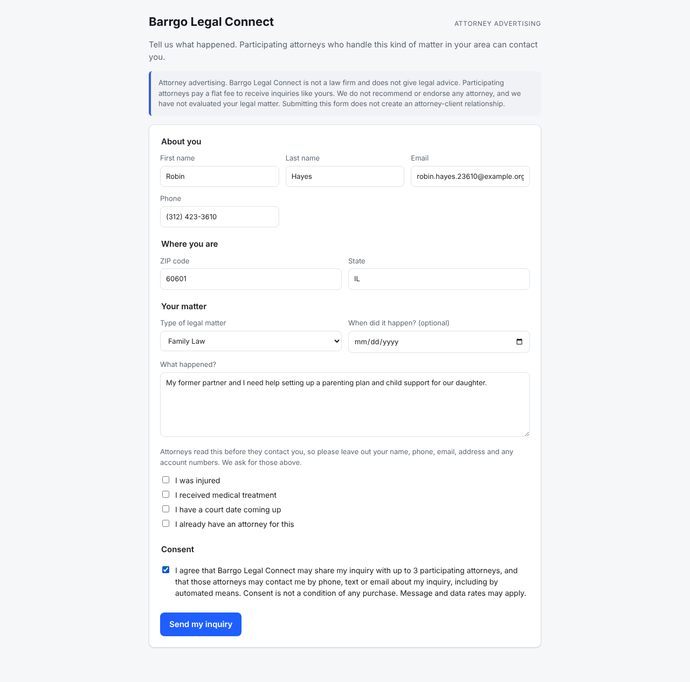
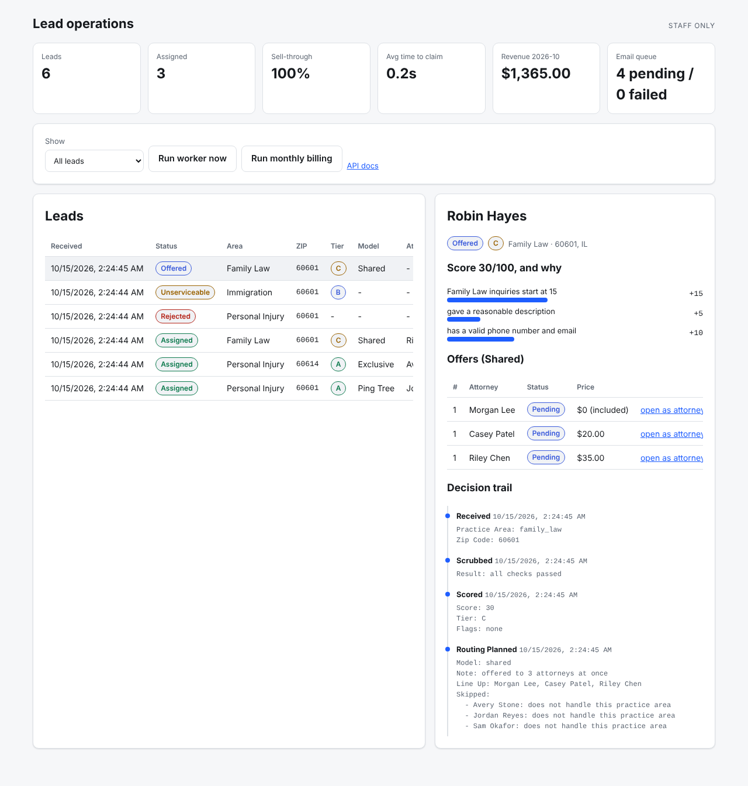
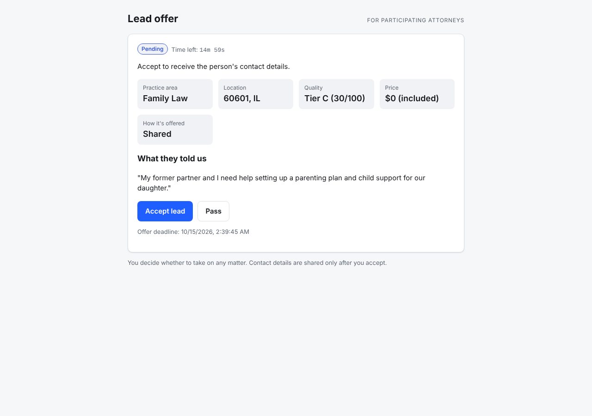
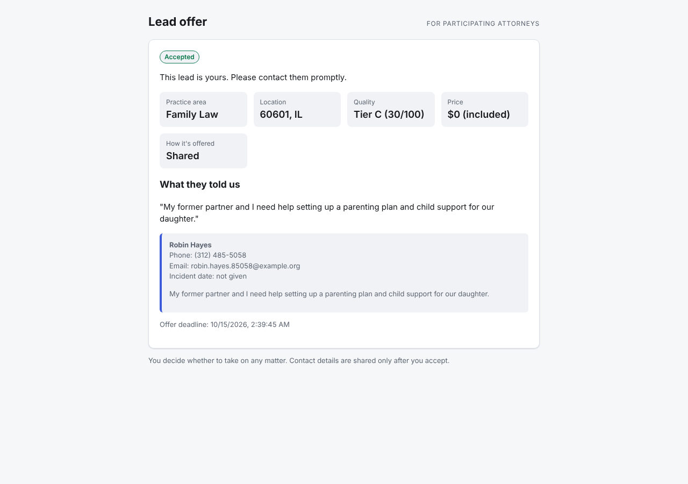

# Barrgo AI Stack

**A self-hosted, open-source replacement for SharePoint (eXo Platform), plus a legal lead
router that captures, scores and distributes consumer legal inquiries to participating
attorneys. It's built to follow attorney-advertising ethics rules from the start.**

[](https://github.com/pat687/barrgo-ai-stack/actions/workflows/ci.yml)


---

## The 30-second version (explained like you're 10)

Imagine a **school lost-and-found desk, but for people who need a lawyer**.

1. Someone fills out a form: *"I got hurt in a car crash in Chicago."*
2. A helper at the desk checks it's real. No robots, no pranks, no repeats.
3. The helper gives it a grade from 0 to 100 and writes down *why*, like a teacher's rubric.
4. Then the helper finds lawyers who are allowed to help (right state, right kind of case,
   right neighborhood) and hands it out in one of three fair ways:
   - **Exclusive:** one lawyer "rents" that neighborhood, so they get it.
   - **Shared:** three lawyers are asked at once. The first to raise their hand wins.
   - **Ping tree:** an auction. Lawyers line up by how much they bid. The top one gets first
     dibs, and if they say no or take too long, the next one gets a turn. The market sets the
     price: you pay $1 more than the next bid in line, never more than your own bid.
5. Lawyers pay a **flat price** for each lead, like buying a ticket. They never pay a cut of
   what they earn, because that breaks the rules for lawyers.

The **eXo Platform** part is the shared office: documents, team spaces, a wiki and online
Word/Excel editing. It runs on your own computer instead of renting Microsoft SharePoint.

More kid-friendly detail: [docs/ELI10.md](docs/ELI10.md).

---

## What's in the box

| Piece | What it does | Tech |
|---|---|---|
| **Lead Router API** | Intake → scrub → score → match → distribute → bill | Python 3.13, FastAPI, SQLAlchemy 2 |
| **Worker** | Times out unanswered offers, advances the ping tree, sends email | Same image, separate process |
| **Intake form** | Public form with disclosures, consent capture and a bot trap | Vanilla HTML/JS, no framework |
| **Attorney offer page** | Signed-link page: preview, countdown, accept/pass | Vanilla HTML/JS |
| **Ops dashboard** | KPIs, lead table, score breakdown, full decision trail | Vanilla HTML/JS |
| **eXo Platform 7.2** | Documents, spaces, wiki, tasks: the SharePoint replacement | Official eXo Community image |
| **ONLYOFFICE** | Edit Word/Excel/PowerPoint in the browser (replaces Office Online) | Official image |
| **PostgreSQL / MySQL / Elasticsearch** | Router data / eXo data / eXo search | Official images |
| **Mailpit** | Local test inbox that catches every email | Official image |

Everything is free and open source, and runs on one machine with `docker compose`.

---

## Architecture



Deeper dive, including sequence diagrams for each distribution model, the data model and
the concurrency design: **[docs/ARCHITECTURE.md](docs/ARCHITECTURE.md)**.

---

## Quick start

Requirements: Docker with Compose v2, `make`, Python 3 (for the demo script only).

```bash
git clone https://github.com/pat687/barrgo-ai-stack.git && cd barrgo-ai-stack
make up      # creates .env with random secrets, builds, starts (about 1 minute)
make demo    # loads 6 fictional attorneys and plays out every scenario
```

| Open | URL |
|---|---|
| Intake form | http://localhost:8000 |
| Ops dashboard (admin key is printed by `make init` and stored in `.env`) | http://localhost:8000/admin |
| Interactive API docs | http://localhost:8000/docs |
| Test inbox (every email sent) | http://localhost:8025 |

Want the SharePoint replacement too? `make up-full` adds eXo Platform, ONLYOFFICE, MySQL,
Elasticsearch and Nginx (about 10 GB RAM; first boot takes several minutes). Then open
http://exoapp.local after adding `127.0.0.1 exoapp.local` to your hosts file.
Migration guide: **[docs/SHAREPOINT_TO_EXO.md](docs/SHAREPOINT_TO_EXO.md)**.

Run `make` on its own to list every command.

### On a Mac with an Apple chip (M1 to M5)

- **`make up` / `make demo`:** works as is. Install Docker Desktop and start it; every
  image the lead router uses has a native Apple-chip version. `make` and `python3` come
  with Apple's Command Line Tools (`xcode-select --install`); the demo script uses only
  Python's standard library, so that `python3` is enough.
- **`make up-full`:** eXo publishes Intel-only images, so the compose file asks for the
  Intel version (`platform: linux/amd64`) and Docker Desktop runs it under emulation. In
  Docker Desktop, turn on **Settings → General → Use Rosetta for x86_64/amd64 emulation on
  Apple Silicon**, and give Docker about 10 GB of memory under **Settings → Resources**.
  Expect eXo's first start to be slower than on an Intel machine. ONLYOFFICE, MySQL,
  Elasticsearch and Nginx run natively. (Checked: without the setting, the eXo download
  fails with "no matching manifest for linux/arm64"; with it, the Intel image downloads.
  eXo itself has not been started on a Mac.)
- **Hosts file:** `sudo nano /etc/hosts`, add `127.0.0.1 exoapp.local`, save.
- **`make test`** (optional; CI runs it on every change) needs Python 3.12 or newer:
  `brew install python@3.13`, then follow [Development](#development) with `python3.13`.

---

## Screenshots

| Intake form (with disclosures and consent) | Ops dashboard (score math and decision trail) |
|---|---|
|  |  |

| Attorney offer: preview with contact details redacted | After accepting: contact details released |
|---|---|
|  |  |

---

## What has been verified

| Check | Result |
|---|---|
| Unit and API tests (`make test`) | 143 passed, plus 5 concurrency tests that run against real Postgres (in CI, or with `TEST_POSTGRES_URL`) |
| Browser regression checks (`make ui-check`, also in CI) | 18 of 18: Pass with Cancel/Escape/Enter, old `?t=` links, double-click accept, countdown, screen-reader status and load errors, field errors with the real reason, no submit before load, table rows with real buttons, refresh that keeps focus and scroll position (focused row on or off screen), live detail panel that doesn't move the page or the offers table, 390px layout, no JS errors. The checks for the dashboard and offer-page fixes were confirmed to fail when the old code is put back |
| Lint and format (`ruff`) | Clean |
| Router stack in Docker on PostgreSQL (`make up`) | Healthy; `make demo` meets all of its built-in expectations |
| Emails through the outbox to Mailpit | 12 of 12 delivered; contact fields withheld from offer emails and the description redacted |
| Pages in headless Chromium (desktop, phone, dark mode) | No console errors, no horizontal scrolling on phone |
| Full eXo profile (`make up-full`) on a fresh database | All services healthy in about 3.5 minutes; login page 200 through Nginx; first-run Account Setup shown |
| eXo on a non-80 port (`EXO_HTTP_PORT=8088`) | eXo links, the proxy port and ONLYOFFICE's host all follow the port with no extra setting; browser, eXo and ONLYOFFICE containers all reach `exoapp.local:8088`, and on port 80 ONLYOFFICE's editor script and health check answer through the proxy (in-browser document editing itself not exercised) |
| eXo lead-capture add-on image (`make exo-addon`) | **Not built here** (eXo's Maven repository was unreachable from the build sandbox). See [infra/exo/README.md](infra/exo/README.md). |
| eXo WebDAV bulk import | Endpoint confirmed (`/webdav/drives`, Digest auth); credential setup not verified. See [migration guide](docs/SHAREPOINT_TO_EXO.md#5-import-into-exo). |

---

## What the demo shows (real output)

```text
Step 1. Five people send in the intake form
  Jamie    personal_injury  60601  ->  offered        (ping tree)
  Alex     personal_injury  60614  ->  assigned       (exclusive territory)
  Taylor   family_law       60601  ->  offered        (shared)
  Bot      personal_injury  60601  ->  rejected       (honeypot + link spam)
  Dana     immigration      60601  ->  unserviceable  (no participating attorney; points to the bar)

Step 2. Why did Jamie's lead get the grade it got?
   +30  Personal Injury inquiries start at 30
   +20  incident happened in the last 30 days
   +20  reports an injury and received medical treatment
    +5  gave a reasonable description
   +10  has a valid phone number and email
  = 85/100, tier A

Step 3. Ping tree: the highest bidder gets the first chance
  round 1: Avery Stone   $ 81.00  pending
  round 2: Jordan Reyes  $ 71.00  queued
  round 3: Sam Okafor    $ 50.00  queued
  Avery passes... Jordan is now being asked, and accepts.

Step 5. Shared: three attorneys are asked at once, first to click wins
  Riley clicks accept  -> HTTP 200 (accepted)
  Morgan clicks accept -> HTTP 409 (another attorney claimed this lead first)

Step 6. Billing: flat fees only
  Avery Stone   $   750.00   (included, territory)
  Jordan Reyes  $    80.00   (per_lead)
  Morgan Lee    $   500.00   (subscription)
  Riley Chen    $    35.00   (per_lead)
```

---

## How one lead flows through the system

| Step | Plain English | Where in the code |
|---|---|---|
| 1. Capture | Save what they typed, plus proof of consent (time, IP, exact wording) | [`services/pipeline.py`](services/lead-router/app/services/pipeline.py) |
| 2. Scrub | Reject no-consent, bots, fake phones, disposable emails, duplicates | [`domain/scrubbing.py`](services/lead-router/app/domain/scrubbing.py) |
| 3. Score | 0–100 with a written reason for every point; tier A/B/C | [`domain/scoring.py`](services/lead-router/app/domain/scoring.py) |
| 4. Match | Active, licensed in the state, handles the practice area, covers the ZIP, under daily cap | [`domain/matching.py`](services/lead-router/app/domain/matching.py) |
| 5. Distribute | Exclusive territory, else the practice area's policy (shared or ping tree) | [`domain/distribution.py`](services/lead-router/app/domain/distribution.py) |
| 6. Respond | Accept / pass / time out, race-safe | [`services/offers.py`](services/lead-router/app/services/offers.py) |
| 7. Bill | Flat per-lead price, or $0 under a subscription/territory | [`services/billing.py`](services/lead-router/app/services/billing.py) |
| 8. Notify | Emails and eXo sync go through a transactional outbox | [`services/outbox.py`](services/lead-router/app/services/outbox.py) |

**Design rule:** everything in `app/domain/` is pure logic with no database and no network.
That's why the business rules read like a spec and test in milliseconds.

### The three distribution models

| Model | When it's used | Who is asked | Who wins | Price |
|---|---|---|---|---|
| **Exclusive** | An attorney rents this ZIP + practice area | Only the owner | Owner, instantly | Included in the monthly territory fee |
| **Shared** (speed to lead) | Default for most practice areas | Up to 3 at once, fewest-leads-today first | First to accept | Each attorney's own flat price |
| **Ping tree** | Personal injury, med-mal, workers' comp | Up to 3, one at a time, highest bid first | First "yes" down the line | Market price: $1 above the next bid (or the floor), never more than the winner's bid |

"Up to 3" is the number the consumer agrees to in the consent text, and no model ever
goes past it. In the ping tree the limit counts attorneys actually asked, so someone who
goes inactive while waiting in line doesn't use up one of the three places. Daily caps and the active flag are checked again at the moment an attorney
accepts, not just when the offer goes out.

**Attorneys set their own bids.** Each attorney gets a private, signed link to a bid page
(`/bids/{id}`; staff send it from the dashboard's Market panel or
`POST /api/v1/admin/attorneys/{id}/bid-link`). For every practice area it shows their place
in line, the bid that would put them first, the lowest bid accepted and what leads sold for in
the last 30 days, and lets them change their bids. Offer emails link back to it. Auction
rules (`ROUTER_AUCTION_PRICING`, `ROUTER_BID_INCREMENT_CENTS`) are configurable.

All of it is configurable in `.env` (`ROUTER_DISTRIBUTION_POLICY`,
`ROUTER_SHARED_MAX_ATTORNEYS`, time limits, floor prices, business timezone). No code changes needed.

---

## Compliance by design

This system is built to stay inside attorney-advertising rules (ABA Model Rules 7.1, 7.2,
5.4 and 1.5(e)). See **[docs/COMPLIANCE.md](docs/COMPLIANCE.md)**. Highlights:

- **No fee-splitting is possible.** The ledger only knows flat fees. No charge type mentions
  settlements or percentages, and the attorney API *rejects* a field like `fee_percent`.
- **Price never depends on outcome.** Attorneys are charged when a lead is delivered, not if
  the person hires them.
- **Honest consumer wording:** "attorney advertising", "not a law firm", "attorneys pay to
  receive inquiries", "we do not recommend any attorney and have not evaluated your matter".
- **Consent evidence on every lead:** exact text, version, timestamp, IP and user agent.
- **Contact details stay hidden** until an attorney accepts. Name, phone and email are
  withheld from offers, and the free-text description is redacted (names, phone numbers,
  emails and street addresses) before attorneys see it. The form also asks people not to
  type contact details there.
- **Never shared beyond consent:** no inquiry goes to more attorneys than the consent text names.
- **No dead ends:** if no attorney covers the area, the person is pointed to their state bar's
  referral service.

> This is engineering, not legal advice. Rules vary by state; have counsel review before launch.

---

## Engineering highlights (the interview version)

- **Race-safe "first click wins."** Two attorneys accepting at the same moment can't both
  get the lead, and an attorney can't blow through their daily cap by accepting several
  offers at once. Every state change is a compare-and-set (`UPDATE ... WHERE status =
  'pending'`), locks are always taken in the same order (lead row, then attorney row), and
  identical intakes take turns through a Postgres advisory lock. Proven with real threads on
  real Postgres in [`test_concurrency_postgres.py`](services/lead-router/tests/test_concurrency_postgres.py),
  and each test was checked to fail when its fix is removed.
- **Transactional outbox.** Emails and eXo updates are written in the same database
  transaction as the change that caused them, then delivered by the worker with exponential
  backoff. No lost emails, and no emails about changes that rolled back.
- **Explainability.** Every lead has an append-only audit trail: who was skipped and why,
  every score point, every offer, every timeout. The dashboard shows it.
- **Signed links, no passwords.** Attorneys act through HMAC-signed links. Nothing to store,
  and they can't be forged. The token sits after `#` in the link, so it never reaches server
  logs, and a bad link looks exactly like a missing offer, so offer IDs can't be probed.
- **12-factor config.** One image runs both API and worker. All settings come from the
  environment, with random secrets generated by `make init`.
- **Secure defaults.** Non-root container, XSS-safe rendering (no `innerHTML` with user data),
  constant-time key comparison, per-IP intake rate limit, forged `X-Forwarded-For` ignored
  (the consent IP can't be faked), timezone-safe timestamps, redacted offer previews.
- **Reviewed adversarially.** Before merge, six independent AI reviewers went through the PR,
  and three skeptics tried to disprove each finding. The 40 findings that survived (cap
  bypass, PII in previews, a ping-tree consent overrun, UI races and more) were fixed, each
  with a regression test.

Ready-made talking points and likely interview questions:
**[docs/INTERVIEW_GUIDE.md](docs/INTERVIEW_GUIDE.md)**.

---

## Project layout

```text
barrgo-ai-stack/
├── docker-compose.yml          # whole stack; eXo services behind the "exo" profile
├── Makefile                    # make up / up-full / demo / test / backup ...
├── .env.example                # every setting, documented; `make init` fills secrets
├── infra/
│   ├── nginx/exo.conf          # reverse proxy for eXo + ONLYOFFICE
│   └── exo/                    # optional: eXo image with the lead-capture add-on
├── scripts/
│   ├── init-env.sh             # creates .env with random secrets
│   └── demo.py                 # narrated end-to-end demo (standard library only)
├── services/lead-router/
│   ├── app/
│   │   ├── domain/             # pure business rules (scrub, score, match, distribute, compliance)
│   │   ├── services/           # use cases (pipeline, offers, billing, outbox, email, eXo sync)
│   │   ├── api/                # thin HTTP routes (public, attorney, admin, pages)
│   │   ├── static/             # intake form, offer page, dashboard
│   │   ├── models.py           # database tables
│   │   ├── schemas.py          # request/response validation
│   │   ├── worker.py           # background worker
│   │   └── seed.py             # six fictional demo attorneys
│   ├── tests/                  # 148 tests: unit, API stories, Postgres concurrency
│   └── Dockerfile              # multi-stage, non-root
└── docs/                       # architecture, compliance, migration, runbook, ADRs, ELI10
```

---

## Documentation

| Doc | For |
|---|---|
| [ELI10.md](docs/ELI10.md) | Anyone. The whole system in kid-friendly language |
| [ARCHITECTURE.md](docs/ARCHITECTURE.md) | Engineers: components, data model, sequences, concurrency |
| [COMPLIANCE.md](docs/COMPLIANCE.md) | Legal/ops: which rule each feature satisfies |
| [SHAREPOINT_TO_EXO.md](docs/SHAREPOINT_TO_EXO.md) | IT: mapping SharePoint concepts to eXo, migration steps |
| [RUNBOOK.md](docs/RUNBOOK.md) | Operators: start, stop, back up, troubleshoot, go live |
| [INTERVIEW_GUIDE.md](docs/INTERVIEW_GUIDE.md) | You: pitch, demo script, Q&A |
| [adr/](docs/adr/) | Architecture Decision Records: why each big choice was made |
| [infra/exo/README.md](infra/exo/README.md) | Optional eXo lead-capture add-on and version matching |

---

## Development

```bash
cd services/lead-router
python3 -m venv .venv && . .venv/bin/activate   # Python 3.12+ (on a Mac: python3.13)
pip install -e ".[dev]"
pytest                      # 143 tests in ~6 s (+5 with TEST_POSTGRES_URL set)
ruff check . && ruff format --check .
uvicorn app.main:create_app --factory --reload   # SQLite, embedded worker, http://localhost:8000
python -m app.seed          # demo attorneys
```

CI ([`.github/workflows/ci.yml`](.github/workflows/ci.yml)) runs lint, all tests (the concurrency
tests against a real Postgres service), a Docker build, validation of both compose profiles, and a
live smoke test of the containerized stack on every pull request.
