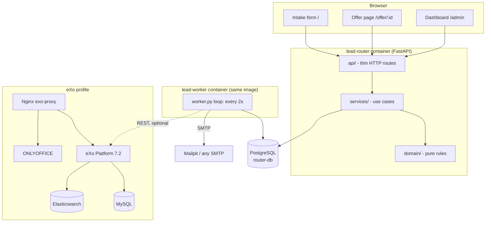
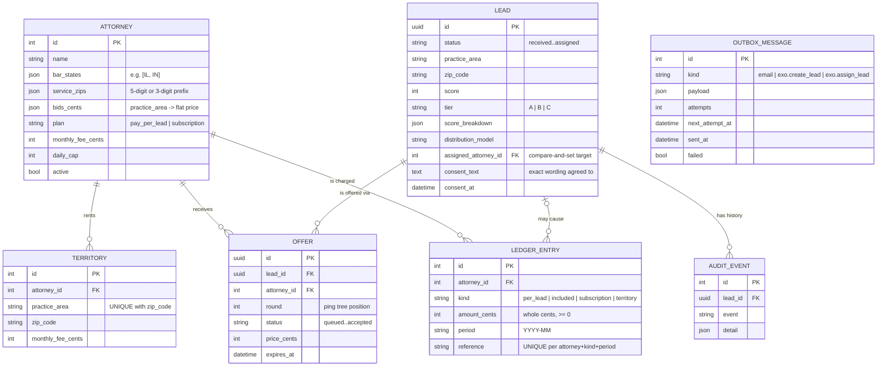
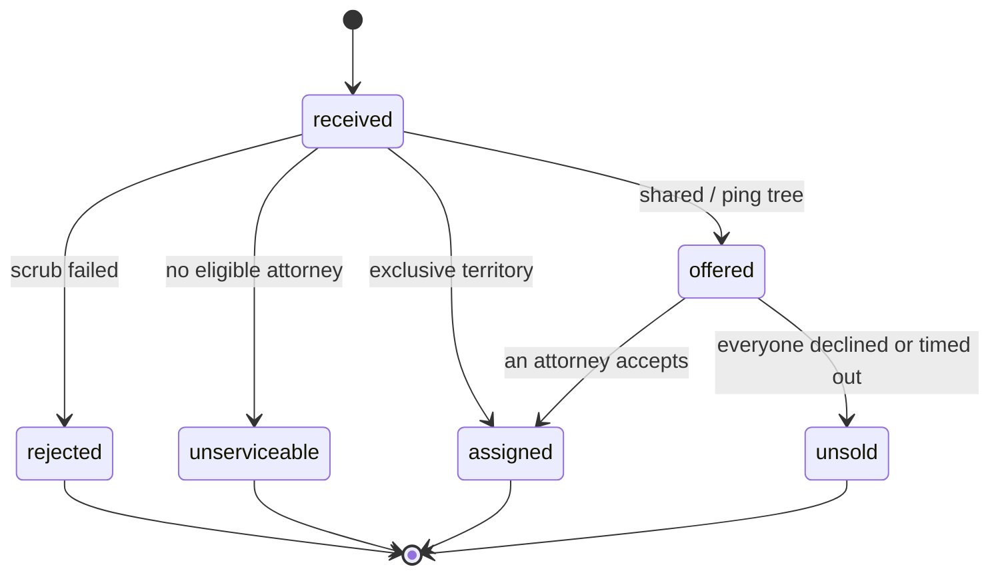
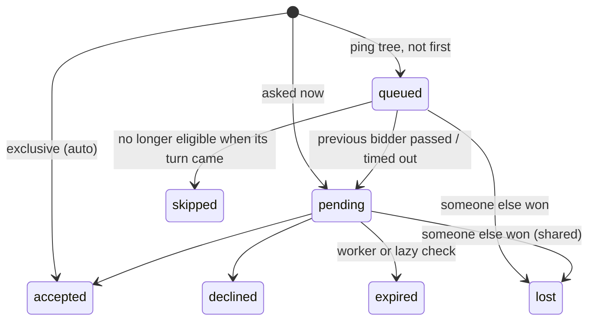
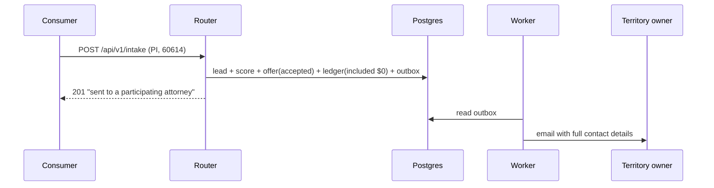
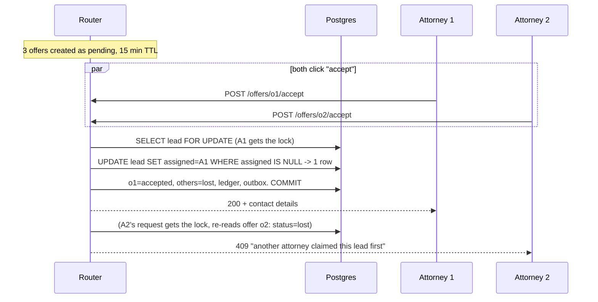
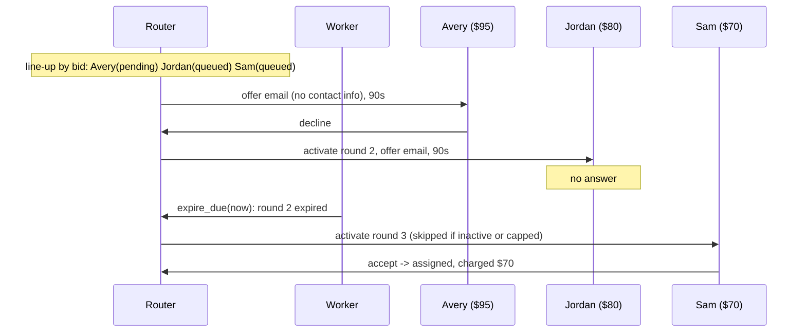
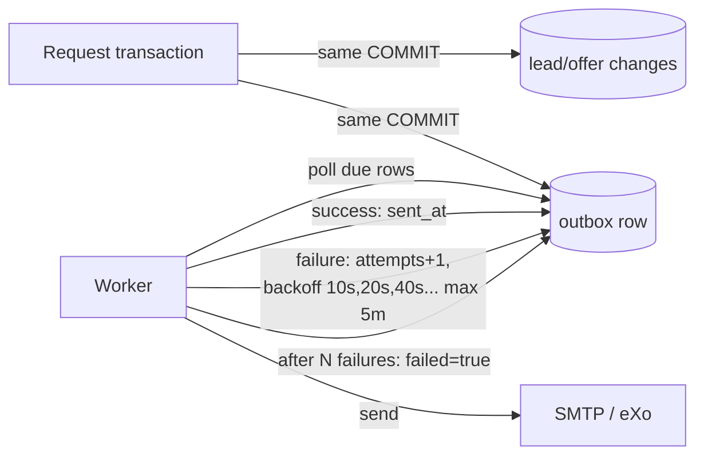

# Architecture

## 1. Goals and constraints

| Goal | How the design meets it |
|---|---|
| Replace SharePoint with free, self-hosted software | eXo Platform Community 7.2 + ONLYOFFICE in Docker, behind Nginx |
| Capture → scrub → score → distribute legal leads | A separate Lead Router service with a pure-logic core |
| Three distribution models | Strategy-style planner: exclusive, shared, ping tree |
| Comply with attorney-advertising rules | Flat-fee-only ledger, disclosures, consent evidence, redacted previews, never more recipients than consented |
| Explain every decision | Append-only audit trail per lead; score breakdown with reasons |
| Never lose or duplicate side effects | Transactional outbox + idempotent billing |
| Run on one machine, scale out later | Stateless API + separate worker; Postgres row locks for coordination |

## 2. Components



### Layering

| Layer | Folder | Rule |
|---|---|---|
| Domain | `app/domain/` | Pure functions and dataclasses. No I/O, no ORM, no clock (time is passed in). |
| Services | `app/services/` | Apply domain decisions to the database; enqueue side effects. Time is a parameter. |
| API | `app/api/` | Validate input, call a service, shape output. No business logic. |
| Worker | `app/worker.py` | Calls `offers.expire_due` and `outbox.deliver_due` on a timer. |

Because time is always passed in, tests can "fast-forward" (for example, expire an offer
90 seconds in the future) without sleeping or mocking the clock.

## 3. Data model



## 4. State machines

### Lead



### Offer



## 5. The three distribution models

### Exclusive



### Shared (speed to lead) and the race



### Ping tree



Every bidder above the floor joins the line, but `offers.advance` stops once as many
attorneys have been *asked* (`activated_at` set) as the consent text allows. Attorneys
skipped while waiting in line were never shown the lead, so they don't count, and the
next bidder gets their place. Anyone still queued when the limit is reached is marked
`skipped` with the reason "line-up full".

## 6. Concurrency design

Four races, four tools:

1. **Double assignment.** Two attorneys accept a shared lead together. The assignment is a
   single conditional update, `UPDATE leads SET assigned_attorney_id=:me WHERE id=:lead AND
   assigned_attorney_id IS NULL`. Exactly one transaction sees `rowcount == 1`.
2. **Stale writes.** Every other state change is a compare-and-set too: an offer moves
   `pending → accepted/declined/expired/skipped` only `WHERE status = 'pending'`, a queued
   offer is activated only `WHERE status = 'queued'`, and a lead becomes `unsold` only
   `WHERE status = 'offered' AND assigned_attorney_id IS NULL`. A writer working from
   out-of-date data changes zero rows instead of overwriting a newer result.
3. **Daily cap overrun.** An attorney with several pending offers accepts them all at once.
   `accept` locks the attorney row and re-counts today's leads (in the business timezone)
   before claiming; the exclusive path locks the territory owner the same way.
4. **Duplicate sale.** The same person submits twice in the same instant. Each intake takes
   `pg_advisory_xact_lock` on hashes of (email, practice area) and (phone, practice area),
   in sorted order, before the duplicate check, so the second waits and then sees the first.

**Deadlocks** are avoided by taking row locks in one fixed order everywhere: the lead row,
then the attorney row, then offers. Accept, decline and the expiry worker all follow it.

On SQLite (local dev, tests) `FOR UPDATE` and advisory locks are no-ops; SQLite allows one
writer at a time, and the compare-and-set updates keep racing readers from overwriting
each other. The real proof runs on Postgres: [`tests/test_concurrency_postgres.py`](../services/lead-router/tests/test_concurrency_postgres.py)
releases several threads through a barrier at once (simultaneous accepts, identical
intakes, cap races, accept vs. expiry), and CI runs it against a Postgres service.

The outbox worker uses `FOR UPDATE SKIP LOCKED`, so several workers can drain the queue
in parallel without sending a message twice.

## 7. Side effects: the transactional outbox



- If the request rolls back, the outbox row never existed, so no ghost emails.
- If SMTP or eXo is down, nothing is lost. Retries back off exponentially, and after
  `ROUTER_OUTBOX_MAX_ATTEMPTS` the message is parked (`failed=true`) and shown on the dashboard.
- Unknown message kinds fail loudly instead of being dropped.
- Emails get their own pass first, then everything else (eXo sync), each with its own time
  budget (`ROUTER_OUTBOX_TIME_BUDGET_SECONDS`, default 5 s). Network calls have short timeouts
  (SMTP 5 s, eXo 5 s connect / 10 s read). A hung eXo server therefore can't delay offer
  emails, and a hung mail server can't stop the same worker from timing out offers.

## 8. eXo integration

eXo is where staff *work*: documents, wiki, tasks. The router is the system of record for
leads. Optionally (`ROUTER_EXO_SYNC_ENABLED=true`) each routed lead is mirrored into eXo's
**lead-capture** add-on through its REST API:

| Router event | eXo call | Auth |
|---|---|---|
| Lead routed | `POST /portal/rest/leadcapture/leadsmanagement/leads` | `token` header (add-on setting) |
| Lead assigned | `GET .../leads?search=<email>` then `PATCH .../assign {id, assignee}` | Basic auth, user in `ux-team` |

These endpoints were read from the add-on's source (`LeadsManagementRest.java`). eXo being
down never blocks routing; the outbox retries. See [infra/exo/README.md](../infra/exo/README.md)
for building eXo with the add-on and the version-matching caveat.

## 9. Security

| Concern | Control |
|---|---|
| Admin API | `X-Admin-Key` header, compared in constant time (`hmac.compare_digest`) |
| Attorney actions | HMAC-SHA256 signed links; nothing stored; invalid or non-ASCII token → 404, the same as a missing offer |
| Token in logs | The token sits after `#` in the link (never sent to the server); the page sends it in an `X-Offer-Token` header, which isn't logged |
| Consumer PII | Name, phone and email withheld until accepted; the description is redacted (names, phones, emails, street addresses) in previews and offer emails |
| XSS | Pages build DOM with `textContent` only; no `innerHTML` with user data |
| Bots and abuse | Honeypot field, link-spam and disposable-domain checks, names limited to letters with no domain-like periods, receipts that contain no submitted text, per-IP intake rate limit |
| Consent IP | Uvicorn honors `X-Forwarded-For` only from `FORWARDED_ALLOW_IPS` (`ROUTER_TRUSTED_PROXY_IPS`, default 127.0.0.1; through a published Docker port the router sees the network gateway instead, see the RUNBOOK); the stored value must parse as an IP |
| Secrets | `make init` generates random values into `.env` (mode 600); compose refuses to start without them |
| Container | Multi-stage build, non-root user (uid 10001), health checks |
| Timestamps | Stored as UTC; naive datetimes are refused at the database boundary |
| Offer page | `Referrer-Policy: no-referrer` so the signed link never leaks to other sites |

## 10. Configuration

Every setting is an environment variable with the `ROUTER_` prefix (see
[`app/config.py`](../services/lead-router/app/config.py) and [`.env.example`](../.env.example)).
`docker-compose.yml` passes every one of them through from `.env`; an empty value means
"use the default". Set them in `.env` and run `make up` again. Examples:

```bash
ROUTER_DISTRIBUTION_POLICY='{"personal_injury":"ping_tree","family_law":"shared","*":"shared"}'
ROUTER_FLOOR_PRICE_CENTS='{"personal_injury":5000,"*":1500}'
ROUTER_SHARED_MAX_ATTORNEYS=3          # also the number named in the consent text
ROUTER_PING_OFFER_TTL_SECONDS=90
ROUTER_BUSINESS_TIMEZONE=America/Chicago
ROUTER_INTAKE_RATE_LIMIT_PER_MINUTE=10
```

## 11. Scaling path

| Load | Change |
|---|---|
| Today (one box) | API + worker + Postgres in compose |
| More traffic | Run several API replicas behind a load balancer. They're stateless. |
| More attorneys (1000s) | Pre-filter candidates in SQL (state, practice area, ZIP3 index) instead of in Python |
| Faster ping trees | Shorten worker interval, or move expiry to a delayed queue (e.g. Postgres `LISTEN/NOTIFY`, Redis) |
| Many workers | Already safe: `SKIP LOCKED` on the outbox, lead-row locks on expiry |
| Many API replicas | The intake rate limiter is per process; add a shared limit at the proxy (or Redis) |
| Schema changes | Add Alembic migrations (tables are created at startup today) |

## 12. Failure modes

| What breaks | What happens | Recovery |
|---|---|---|
| SMTP down | Emails wait in the outbox; dashboard shows the pending count | Automatic retry with backoff |
| eXo down | Sync messages retry; routing unaffected | Automatic |
| Worker down | Offers don't time out on schedule; the offer page and accept/decline still expire overdue offers when they're touched | Restart worker; it catches up |
| Router DB down | `/readyz` returns 500 and the container is marked unhealthy (Docker doesn't restart it for that); requests fail | Once Postgres is back, `pool_pre_ping` reconnects automatically |
| SMTP or eXo hangs | Each worker cycle stops sending after its time budget; offers still expire on schedule | Messages retry until the server answers |
| Two accepts at once | One 200, one 409 | By design |
| Billing run twice | Second run creates nothing | Unique key on ledger |
