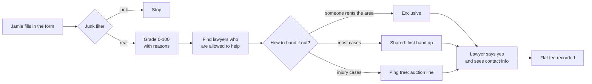

# The whole system, explained like you're 10

## The big idea

Some people need a lawyer but don't know where to find one. Some lawyers want more people
to help. This system is the **matchmaker in the middle**, and it plays fair.

It has two halves:

| Half | It's like... | Real name |
|---|---|---|
| The **office** where the team keeps files, notes and to-do lists | A clubhouse with a filing cabinet, a whiteboard and a shared notebook | **eXo Platform** (instead of Microsoft SharePoint) |
| The **mail room** that sorts requests for help and delivers them to lawyers | A school lost-and-found desk with a very organized helper | **Lead Router** |

---

## Part 1: The clubhouse (eXo Platform)

Lots of companies rent their online office from Microsoft (that's SharePoint). Renting costs
money every month, and your files live on someone else's computer.

eXo Platform is a **free** online office you run on **your own computer**. It has:

- **Spaces:** a room for each team, like "Intake Team" or "Attorney Network".
- **Documents:** a shared filing cabinet. You can even edit Word and Excel files right in
  the browser (that's the ONLYOFFICE part).
- **Notes:** a wiki where you write down how things are done.
- **Tasks:** to-do lists for the team.

Since it runs on your own computer, nobody else holds your files, and nobody sends you a
bill every month.

---

## Part 2: The mail room (Lead Router)

### Step 1: Someone asks for help

Jamie got rear-ended at a red light. Jamie goes to the website and fills in a form: name,
phone, ZIP code, what happened, and checks a box saying **"yes, lawyers may contact me."**

That checkbox matters. Without it, the system stops right there.

### Step 2: The junk filter

Not every form is real. The helper throws away:

- **Robots.** The form has a secret invisible box. People can't see it, so they leave it
  empty. Robots fill in every box, so if it has something in it, that's a robot.
- **Fake phone numbers** like 000-000-0000.
- **Throwaway email addresses** that only last 10 minutes.
- **Copies:** the same person asking about the same thing twice in a month.

### Step 3: The grade

The helper grades each request from 0 to 100, like a teacher with a rubric, and **writes
down every reason**:

```
 +30  car crash cases start at 30
 +20  it happened in the last 30 days
 +20  they got hurt and saw a doctor
  +5  they explained what happened
 +10  their phone and email work
 = 85 out of 100  ->  an "A"
```

If someone asks "why did this get an A?", you can point to the exact lines. Nothing is a
mystery.

### Step 4: Who's allowed to help?

A lawyer can only get Jamie's request if **all** of these are true:

- They're working today (not on vacation).
- They're allowed to practice law in Jamie's state.
- They handle car crash cases.
- They cover Jamie's neighborhood (ZIP code).
- They haven't hit their limit for the day.

If a lawyer is skipped, the helper writes down why.

### Step 5: Handing it out (three fair ways)

**Exclusive: "I rent this street."**
One lawyer pays every month to own a neighborhood. Requests from there go straight to them.
It's like having the only lemonade stand allowed on your block.

**Shared: "First hand up wins."**
Three lawyers are asked at the same time. The first one to say "I'll take it!" gets it.
If two press the button at the *exact* same moment, the computer is built so only one
can win. No ties, no fights.

**Ping tree: "Auction line."**
Up to three lawyers line up by how much they offered to pay. The top one gets asked first
and has 90 seconds to answer. If they say no or don't answer, the next one in line is asked.
Like a fair auction, the winner doesn't pay their whole bid: they pay $1 more than the next
lawyer's bid, and never more than their own. Lawyers can't see each other's bids, only
their own place in line. Lawyers on a monthly plan don't bid at all; they get asked after
the lawyers who pay for each lead.

Why only three? Jamie's checkbox said "up to 3 lawyers may contact me", so the computer
never shows the request to a fourth. And a lawyer who has hit their daily limit can't
sneak one more, even by clicking fast.

### Step 6: Keeping it private

The lawyer being asked only sees a **preview**: what kind of case, which neighborhood, the
grade, and Jamie's story with anything private blacked out. If Jamie wrote "call me at
312-555-0142" in the story, the lawyer sees "call me at [redacted]". Jamie's name, phone
and email are only shown once a lawyer actually says yes.

### Step 7: Paying fairly

Lawyers pay a **flat price**, like buying a ticket:

- "$80 for this request", or
- "$500 a month for as many as I get".

They **never** pay a piece of the money they win for their client. In the rules for
lawyers, that's called fee-splitting, and it isn't allowed. The system is built so
there isn't even a button for it.

### Step 8: Telling everyone

Emails go out: "You have a new request!" to the lawyer and "We got your message!" to Jamie.
These go into an **outbox** first, like a mail tray. A helper (the worker) empties the tray
every 2 seconds. If the mail truck is broken, the letters stay in the tray and get sent
later. Nothing gets lost.

### What if nobody can help?

If no lawyer covers Jamie's area, Jamie is told so honestly, and pointed to their state
bar association, which runs a free-to-ask lawyer referral service.

---

## Being honest is built in

The website always says, in plain words:

- "This is an **advertisement**."
- "We are **not a law firm**."
- "Lawyers **pay** to get these requests."
- "We **don't recommend** any lawyer, and we haven't judged your case."

---

## One picture


